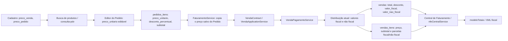

# Sprint 2.1 / 2.2 — Auditoria e integração do preço do Pedido

**Status:** sugestão de `preco_pedido` e snapshots implementados no workspace; correção de totais e aprovação da regressão financeira continuam pendentes.  
**Implementação de `preco_pedido` no editor do Pedido:** implementada para novas seleções.  
**Escopo executado:** alterações aditivas no schema e no fluxo de Pedido, testes focados e análise de totais. Nenhuma migração foi executada no banco oficial; nenhum commit, push, merge ou reset foi executado.

> A auditoria foi feita sobre o estado atual do workspace. Já havia alterações locais, inclusive nos serviços de Pedido, Faturamento, fiscal e nas rotas de Pedido/Produto, além dos testes de preço não rastreados. Elas foram preservadas; este documento não tenta atribuí-las a esta Sprint.

## 1. Fluxo observado no código

### 1.1 Cadastro → editor do Pedido

- O schema de `produtos` declara `preco_venda` e `preco_pedido`; a migração de `preco_pedido` é aditiva. A rota de leitura por ID seleciona `p.*`, portanto o campo configurado pode chegar na resposta do produto.
- A busca usada pelo editor é `/produtos/consulta-pdv/buscar`. Em [frontend/erp/js/pedidos.js](frontend/erp/js/pedidos.js), `buscarProdutos` monta o valor apresentado com `preco_promocional` quando existe e, caso contrário, com `preco_venda`.
- Ao selecionar um resultado, `aplicarProdutoSelecionado` também busca `/produtos/:id`, mas prioriza o argumento de preço vindo da busca; no fallback, usa promoção ou `preco_venda`. **Não lê `produto.preco_pedido`.** Assim, a resposta de detalhe já possuir o campo não o torna preço sugerido no Pedido.
- O input de preço é editável. A seleção inicial do preço e a edição manual acabam no mesmo campo de trabalho: `itensEditor[].preco_unitario`.

### 1.2 Editor → Pedido persistido

- `adicionarItem` e os eventos de edição calculam o subtotal da linha como `quantidade × preco_unitario × (1 − desconto_percentual/100)`, arredondado a duas casas.
- `calcTotaisDetalhe` soma os subtotais das linhas, subtrai o desconto de cabeçalho e adiciona o frete.
- `salvarPedido` envia `preco_unitario`, `desconto_percentual` e `subtotal` por linha; não envia nem `preco_venda` nem `preco_pedido`.
- As rotas `/api/pedidos` encaminham a operação para `PedidoOperacionalService`. `montarCabecalho` valida e normaliza preço, desconto por item e subtotal. `PedidoRepository` persiste o preço escolhido em `pedidos_itens.preco_unitario`.
- Na reabertura, `abrirEditor` carrega o preço salvo da linha. A substituição preserva os snapshots de nome; o preço operacional histórico é o que está persistido no item do Pedido, não um preço relido do cadastro. O teste focado confirma que alteração posterior dos preços do produto não sobrescreve o preço já salvo.
- A consulta de snapshots do produto não captura `preco_venda` nem `preco_pedido`. Portanto o Pedido histórico conserva o preço escolhido e subtotal, mas hoje não registra qual preço cadastrado originou a sugestão nem se o operador alterou a sugestão.

### 1.3 Pedido → faturamento → venda

- `FaturamentoService.faturarPedido` carrega o Pedido salvo e `montarPayloadVendaDoPedido` copia cada `item.preco_unitario`, quantidade, desconto percentual e subtotal para o contrato da venda. Não há consulta ao preço corrente do produto nessa conversão, nem leitura de `preco_pedido`.
- O contrato é encaminhado pelo `VendaApplicationService` ao `VendaPagamentoService`. A conversão da Sprint 3.1 tem teste próprio para origem, total, itens e delegação ao núcleo.
- O núcleo envia os itens para `distribuirItensVendaComValorFiscalEfetivo`. A distribuição calcula os valores fiscais a partir do preço unitário e quantidades fiscais/não fiscais; o cálculo de valores da linha usa `quantidade × preco_unitario`. O valor fiscal líquido aplica o desconto/acréscimo de venda recebidos pelo núcleo.
- O caminho de persistência de venda grava em `vendas` os valores do cabeçalho — inclusive `total`, `desconto`, `valor_fiscal` e `valor_nao_fiscal` — e em `vendas_itens` o `preco_unitario`, `preco_unitario_interno`, `desconto_percentual`, `subtotal`, quantidades e valores fiscal/não fiscal. Há dois caminhos de persistência (venda a prazo e venda regular) com os mesmos campos relevantes.
- A tabela de venda não recebe um campo `preco_pedido`; a origem configurada e eventual edição do operador não podem ser reconstruídas a partir do preço cadastrado atual.

### 1.4 Venda → documento fiscal

- `CentralFaturamentoService` lê os itens de `vendas_itens` e junta os atributos fiscais do produto, usando `p.nome` como nome do produto e mantendo os dados fiscais da venda.
- `nfeCentralService` seleciona o preço unitário e os valores fiscal/não fiscal persistidos na venda; para a ficha da nota, a quantidade é fiscal e o valor prioriza `valor_fiscal`.
- `modeloTotais` prioriza `item.valor_fiscal` para os totais, com fallback legado para preço unitário × quantidade ou subtotal quando esse campo não está disponível. O XML usa o valor fiscal do item e não consulta `preco_pedido`; o nome fiscal continua vindo do nome principal (`p.nome`/`produto_nome`).
- Portanto, embora a sugestão atual do Pedido não leia `preco_pedido`, **um preço efetivamente escolhido e salvo no Pedido é insumo do faturamento e pode influenciar os valores fiscal/não fiscal gerados pelo fluxo existente**. A proposta abaixo não altera esses consumidores nem recalcula uma venda a partir do cadastro corrente.

## 2. Arquivos, métodos e contratos envolvidos

| Etapa | Arquivo e método/contrato | Contrato observado |
|---|---|---|
| Cadastro/schema | `backend/database.js`; `backend/rotas/produtos.js` (`normalizarProdutoResposta`, `GET /:id`, `GET /consulta-pdv/buscar`) | `preco_venda` permanece existente; `preco_pedido` é nullable e a rota de detalhe retorna as colunas do produto. |
| Sugestão e edição | `frontend/erp/js/pedidos.js` (`buscarProdutos`, `aplicarProdutoSelecionado`, `adicionarItem`, `renderItens`, `calcTotaisDetalhe`, `salvarPedido`) | A UI sugere promoção ou `preco_venda`; o operador altera `preco_unitario`. |
| Pedido operacional | `backend/rotas/pedidos.js`; `backend/services/pedido/PedidoOperacionalService.js` (`montarCabecalho`, `criar`, `atualizar`) | Recebe e valida o preço escolhido, descontos, subtotais e total do Pedido. |
| Persistência/reabertura | `backend/services/pedido/PedidoRepository.js` (`montarInsertPedidoItem`, `obterPorId`, `substituirPedido`) | `pedidos_itens.preco_unitario` e `subtotal` são o histórico operacional existente; snapshots atuais são de identidade/apresentação, não da origem do preço. |
| Caminho alternativo/legado | `backend/services/pedido/PedidoService.js` (`normalizarItens`, `criarPedido`) | Serviço de criação mínima separado do fluxo operacional da UI; também recebe preço do item, não consulta `preco_pedido`. |
| Conversão Pedido → venda | `backend/services/faturamento/FaturamentoService.js` (`montarPayloadVendaDoPedido`, `faturarPedido`) | Copia o preço salvo do Pedido para o contrato de venda e atualiza o vínculo/status do Pedido. |
| Porta e núcleo de venda | `backend/services/vendas/VendaContract.js` (`criarVendaContract`); `VendaApplicationService.js`; `VendaPagamentoService.js` (`criarVenda`) | O contrato preserva o payload; o núcleo aplica a distribuição atual e persiste cabeçalho e itens de venda. |
| Distribuição comercial/fiscal | `backend/services/distribuidorEstoqueVenda.js` (`calcularValoresFiscaisItem`, `distribuirItensVendaComValorFiscalEfetivo`) | Produz os valores fiscal/não fiscal a partir dos dados efetivos recebidos pela venda e do desconto/acréscimo global. |
| Documento fiscal | `backend/services/faturamento/CentralFaturamentoService.js`; `backend/services/fiscal/nfeCentralService.js`; `backend/services/fiscal/modeloTotais.js`; `backend/services/fiscal/xmlBuilder.js` / `xmlBuilderNfeVenda.js` | Consome valores e atributos já persistidos na venda, sem usar `preco_pedido`. |

## 3. Contrato atual de cada valor

| Valor | Fonte e significado atual | Persistência/rastreio atual |
|---|---|---|
| Preço comercial cadastrado | `produtos.preco_venda`; a UI também pode preferir um preço promocional recebido na busca. | Cadastro do produto; não é copiado para snapshots do item de Pedido. |
| Preço do Pedido configurado | `produtos.preco_pedido`, nullable. | Cadastro do produto; **não é usado na sugestão atual** e não é copiado para Pedido/venda. |
| Preço efetivamente escolhido | Campo editável `preco_unitario` do editor. | `pedidos_itens.preco_unitario`; convertido para `vendas_itens.preco_unitario` e `preco_unitario_interno`. |
| Total operacional do Pedido | Soma dos subtotais de linha − desconto de cabeçalho + frete. | `pedidos.total`, além dos descontos/subtotais por item e campos de cabeçalho. |
| Valores considerados pelo faturamento | O conversor envia `pedido.total` ajustado com os valores de frete, acréscimo e desconto derivados do Pedido ou do corpo da requisição; o núcleo recebe ainda os preços e descontos por item. | `vendas.total`, `vendas.desconto`, `vendas_itens.preco_unitario/subtotal` e valores fiscal/não fiscal. |
| Valor fiscal do documento | Valor fiscal persistido pela distribuição atual; consumido pelo fluxo de emissão e pelos totais fiscais. | `vendas.valor_fiscal` e `vendas_itens.valor_fiscal`; não é sinônimo automático de `preco_unitario`. |

## 4. Acoplamentos e riscos identificados

1. **O preço de cadastro do produto não é o preço histórico do Pedido.** A UI salva o valor sugerido/editado; faturamento usa esse valor salvo. Recalcular preço na expedição a partir do cadastro atual alteraria o contrato histórico.
2. **Não há proveniência do preço.** `preco_unitario` identifica o preço escolhido, mas os registros atuais não distinguem preço comercial, preço configurado para Pedido, preço promocional, preço sugerido ou alteração manual.
3. **A ordem de precedência da sugestão precisa ser definida na implementação.** Hoje a busca fornece promoção ou `preco_venda`, e esse valor é priorizado sobre qualquer preço lido no detalhe. Uma integração que apenas acrescente leitura de `preco_pedido` no detalhe ainda pode ser anulada pelo argumento vindo da busca.
4. **Desconto por item versus base do núcleo — divergência reproduzida.** Com quantidade 2, preço unitário 10, desconto de linha 10%, subtotal do Pedido 18 e desconto global 0, uma chamada ao distribuidor retornou base e valor fiscal líquido 20. O distribuidor calcula quantidade × preço unitário e não usa o subtotal de 18 nem `desconto_percentual` para esse cálculo. Assim o subtotal enviado e a base distribuída divergem em 2 neste caso concreto.
5. **Desconto/frete/acréscimo no total da conversão — divergência reproduzida.** A UI calcula `pedido.total = subtotal − desconto de cabeçalho + frete`. Com subtotal de linhas 18, desconto 2 e frete 5, o Pedido total é 21. Chamando `montarPayloadVendaDoPedido` com esses valores e sem overrides no corpo, o total do payload foi 24 (`21 + 5 − 2`). A conversão reaplica frete e desconto nessa condição.
6. **Zero no cadastro não é ausência de preço.** Usar `preco_pedido || preco_venda` trataria zero como ausente e violaria a regra aprovada. Além disso, o serviço operacional rejeita Pedido com soma de itens igual a zero; um item individual de valor zero e um Pedido composto somente por valores zero são cenários distintos.
7. **Desalinhamento entre preço unitário e valor fiscal.** A emissão consome `valor_fiscal`/quantidade fiscal, não apenas o preço unitário. Qualquer preço escolhido diferente do vigente pode alterar os valores calculados pelo fluxo de venda; a integração não pode substituir silenciosamente valores na etapa de faturamento ou no Motor Fiscal.

## 5. Contrato implementado para integração isolada

Implementado conforme a especificação Sprint 2.2 fornecida. As alterações limitam-se à sugestão, aos snapshots e à preservação do preço escolhido no Pedido; não mudam cálculo de venda, faturamento, distribuição fiscal/não fiscal ou documento fiscal.

1. Ao selecionar um produto, determinar uma única **sugestão congelada** para aquela linha:
   - se `preco_pedido !== null` e for um valor monetário válido, sugerir exatamente `preco_pedido`, inclusive zero;
   - se `preco_pedido === null`, preservar o comportamento comercial atual: preço promocional aplicável, se houver; caso contrário, `preco_venda`;
   - nunca usar teste de truthiness (`||`) para decidir se `preco_pedido` está configurado.
2. Manter `preco_unitario` como **preço escolhido pelo operador** e como único campo de preço operacional que alimenta o payload existente de faturamento. A sugestão preenche o editor; não reprecifica Pedido já salvo, não é recalculada ao reabrir e não é lida novamente na expedição.
3. Preservar, em campos aditivos e nullable de `pedidos_itens`, os valores do momento da seleção: `preco_venda_snapshot`, `preco_pedido_snapshot` e `preco_sugerido_snapshot`; manter `preco_unitario` como escolha final. Guardar também a origem da sugestão (`PRECO_PEDIDO`, `PROMOCAO` ou `PRECO_VENDA`) e um indicador de edição manual para distinguir escolha de alteração. Os nomes e a necessidade exata de cada coluna são decisão de contrato; campos legados ficam `NULL`, sem backfill destrutivo.
4. Na alteração/reabertura, preservar os snapshots de preço da linha original, assim como já se preserva o snapshot de nome. Só uma nova seleção explícita de produto cria uma nova sugestão. Ajustar quantidade recalcula subtotal usando o preço escolhido, sem atualizar os snapshots do cadastro.
5. Não adicionar leitura de `preco_pedido` em `FaturamentoService`, `VendaPagamentoService`, distribuidores, documentos fiscais ou XML. O conversor continua consumindo o `preco_unitario` histórico aprovado no Pedido; alterações no esquema ou semântica de venda/fiscal exigem contrato e aprovação separados.

Esta integração foi aplicada em `frontend/erp/js/pedidos.js`, `backend/services/pedido/PedidoOperacionalService.js`, `backend/services/pedido/PedidoRepository.js` e `backend/database.js`. O preço sugerido e a escolha do operador seguem separados; a conversão para venda continua recebendo somente `preco_unitario` persistido.

### Registro e apresentação de divergências

Com os snapshots, reportar sem mutação:

- `diferença configurada`: `preco_pedido_snapshot − preco_venda_snapshot`;
- `diferença da escolha`: `preco_unitario − preco_sugerido_snapshot`;
- `diferença de faturamento`: total efetivamente persistido na venda − `pedidos.total`, exibida com a decomposição de frete, acréscimo e descontos;
- diferença fiscal: valores fiscais persistidos versus o total comercial da venda, discriminando parcela não fiscal.

As diferenças devem ser informativas e rastreáveis; não arredondar, substituir ou bloquear automaticamente valores existentes. O valor que o operador escolheu permanece explícito no Pedido; os valores posteriores da venda e do documento continuam sob as regras atuais do faturamento e Motor Fiscal.

## 6. Casos `NULL`, zero e preço editado

- **`preco_pedido = NULL`:** sem configuração; aplicar exatamente a sugestão comercial já existente, incluindo a precedência de promoção que for aprovada.
- **`preco_pedido = 0`:** configuração explícita; mostrar zero no editor e congelar zero como sugestão. Não substituir silenciosamente por `preco_venda`. Validar separadamente a regra existente que rejeita Pedido cujo total/soma de itens seja zero.
- **Preço editado:** o número digitado passa a ser o `preco_unitario` escolhido. Persistir tanto a sugestão que foi exibida quanto a escolha final; faturamento continua recebendo a escolha final já salva, nunca o preço corrente do cadastro.
- **Pedido existente/legado:** manter `preco_unitario` e subtotal já gravados; snapshots novos ficam `NULL` para itens antigos e não há recálculo retroativo.

## 7. Testes exigidos antes da implementação futura

1. Cadastro/API: leitura e atualização de `preco_venda` e `preco_pedido`, cobrindo `NULL`, zero, valor positivo e legado sem as colunas.
2. Seleção no editor: `preco_pedido` positivo tem precedência; zero explícito é exibido; `NULL` mantém o comportamento comercial atual; cobrir busca com promoção, busca sem promoção e detalhe por ID.
3. Edição: operador muda o preço sugerido; quantidade/desconto atualizam o subtotal; o valor escolhido e os snapshots sobrevivem a salvar, reabrir, editar e mudança posterior do cadastro.
4. Pedido antigo: abrir/editar sem substituir preço ou subtotal histórico; sem backfill de snapshots.
5. Conversor Pedido → venda: verificar que usa o `preco_unitario` salvo (inclusive edição manual), não busca `preco_venda`/`preco_pedido` atual e não muda contrato de pagamento.
6. Descontos e totais: testar desconto percentual por linha, desconto do cabeçalho, frete e acréscimo em separado e combinados; medir subtotal do Pedido, total enviado, total da venda, pagamentos e valores fiscal/não fiscal. Fixar a regra correta antes de qualquer alteração.
7. Persistência e fiscal: validar `vendas_itens.preco_unitario`, `subtotal`, `valor_fiscal` e `valor_nao_fiscal`; comparar NF-e/NFC-e, `modeloTotais` e XML em casos sem divergência e com preço escolhido diferente do cadastro. Confirmar que nome fiscal, tributos e cálculos não passaram a ler `preco_pedido`.
8. Regressão da rota de venda pelo Pedido, fluxo de pedidos históricos, orçamento, reabertura e faturamento a prazo/regular.

## 8. Testes executados

Os testes que carregam o banco foram executados com `DB_DIR` temporário isolado; nenhum banco oficial foi aberto. Os resultados incluem testes executados após a integração Sprint 2.2.

| Teste | Resultado |
|---|---|
| `tests/pedidos/preco-pedido-nome-comercial.test.js` | **Passou** — 6 testes: snapshots positivos e zero, sugestão contra promoção, fallback para comercial, preço final editado no payload de venda, edição/reabertura e preservação de snapshots legados nulos. |
| `tests/produtos/nome-comercial-preco-pedido-http.test.js` | **Passou** — 1 teste; verificou também que as quatro colunas aditivas estão disponíveis após inicialização do banco temporário. |
| `tests/faturamento/sprint31-faturamento.test.js` | **Passou** — 8 testes, incluindo conversão Pedido → VendaContract e persistência de Pedido. |
| `tests/faturamento/sprint32-nfe.test.js` | **Passou** — 7 testes. |
| `tests/vendas/fiscal-402-desconto-pagamento.test.js` | **Passou** — 27 testes. |
| `tests/vendas/rc7101-valor-fiscal-liquido.test.js` | **Passou** — 15 testes. |
| `tests/vendas/sprint-2-7-recalculo-preco-quantidade.test.js` | **Passou** — 16 testes. |
| `tests/fiscal/danfe-itens-venda.test.js` | **Passou** — teste executado com 8 verificações internas de itens/valores da DANFE. |
| `tests/faturamento/sprint35-pedidos-ui.test.js` | **Falhou** — 3 passaram, 1 falhou: o teste exige a expressão `page === 'pedidos'`; o `core.js` atual usa mapa de páginas e a verificação `p === 'pedidos'`. |
| `tests/faturamento/sprint314-orcamento-pedidos.test.js` | **Falhou** — 6 passaram, 1 falhou: o teste exige o SQL literal `WHERE p.status IN (...)`; o filtro atual é montado em um array `where` e concatenado na consulta. O critério de status continua restrito a `AGUARDANDO_FATURAMENTO`. |
| `tests/faturamento/rc412-ponte-reserva-pedido-nucleo.test.js` | **Falhou/não concluído** — exit 1 após cerca de 80 s, sem testes aprovados; a execução apresentou mensagens de migração SQLite/colunas duplicadas. Não foi repetido para evitar prolongar uma execução sem diagnóstico específico de preço. |

O `node --check` passou para `backend/database.js`, `PedidoRepository.js`, `PedidoOperacionalService.js` e `frontend/erp/js/pedidos.js`. As mensagens de colunas duplicadas nos testes que inicializam `database.js` ocorreram em bancos temporários; não foram silenciadas por alteração de código.

## 9. Pendências e decisões para aprovação

1. Confirmar a precedência entre `preco_pedido` e promoção vigente quando ambos existirem.
2. Aprovar os snapshots aditivos e o contrato de proveniência/edição manual; decidir se esses valores também precisam ser materializados na venda ou se a referência ao Pedido é suficiente.
3. Definir tratamento dos descontos percentuais por item no contrato Pedido → venda e sanar a ambiguidade de reaplicação de desconto/frete/acréscimo antes de alterar preços sugeridos.
4. Decidir se preço zero é permitido apenas como linha de Pedido ou também em Pedido cujo total seja zero, respeitando validações existentes.
5. Definir se divergências são apenas exibidas ou se haverá bloqueio/aceite explícito; a proposta desta auditoria é apenas registrar e exibir.
6. Aprovar a regra financeira para as divergências reproduzidas. A sugestão e a rastreabilidade de `preco_pedido` foram implementadas, mas não se deve declarar a Sprint 2.2 concluída enquanto os totais/descontos não forem decididos e os testes que falharam ou não terminaram não forem resolvidos ou formalmente aceitos.

## 10. Relatório final da Sprint 2.2

### Arquivos alterados nesta implementação

- `backend/database.js` — quatro colunas nullable aditivas em `pedidos_itens`, também declaradas na criação da tabela.
- `backend/services/pedido/PedidoRepository.js` — captura dos preços e sugestão no momento da inclusão; preservação literal dos snapshots, inclusive `NULL` e zero, durante a edição; compatibilidade com schema legado.
- `backend/services/pedido/PedidoOperacionalService.js` — validação e passagem dos campos de snapshot e origem controlada; cópia dos snapshots ao duplicar Pedido.
- `frontend/erp/js/pedidos.js` — prioridade de `preco_pedido`, fallback comercial/promoção apenas quando `NULL`, escolha manual persistida e snapshots mantidos em quantidade/desconto, edição e reabertura.
- `tests/pedidos/preco-pedido-nome-comercial.test.js` e `tests/produtos/nome-comercial-preco-pedido-http.test.js` — cobertura da prioridade, zero/`NULL`, snapshots, edição, conversão e schema.
- Este relatório — diagnóstico reproduzível, implementação e resultados de testes.

### Regra e limites resultantes

- `preco_pedido` válido, inclusive zero, é o valor inicial para uma nova seleção.
- `preco_pedido = NULL` mantém a promoção aplicável ou `preco_venda` conforme a busca comercial atual.
- `preco_unitario` segue como preço efetivamente escolhido; é o único preço enviado pelo conversor Pedido→Venda. Snapshots registram `preco_venda`, `preco_pedido`, sugestão e origem.
- Itens antigos não recebem snapshots retroativos; seus preços/subtotais salvos permanecem e snapshots desconhecidos ficam `NULL`.
- Nenhuma regra fiscal, financeira, XML, estoque ou cálculo do faturamento foi modificada.

### Pendência financeira que requer aprovação

As duas reproduções numéricas da seção 4 demonstram diferenças reais entre subtotal/total operacional e os valores calculados na distribuição/conversão. Não foi alterada nenhuma fórmula: definir se o desconto por linha deve ser aplicado dentro do subtotal distribuído, se `pedido.total` já é líquido e como o payload trata frete/desconto mudaria um contrato financeiro/fiscal ainda não definido. Essa parte fica bloqueada até aprovação da regra esperada.

Não foi aberto banco oficial, executada migração de produção ou utilizado comando Git destrutivo. A suíte focada não está integralmente aprovada: há duas falhas de expectativas textuais e uma falha/execução não concluída da ponte de reservas, listadas acima.
