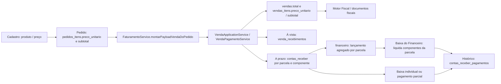

# Sprint 2.3.1 — Validação integrada financeira

## Resultado

**Parcialmente validada; não liberar como aprovação integrada definitiva.**

Foram reproduzidos e corrigidos dois problemas no pagamento parcial agrupado: o financeiro podia ser marcado recebido ao quitar apenas um componente da parcela, e a baixa podia sobrescrever um saldo lido antes de outra atualização. Agora o status do financeiro é derivado do conjunto de componentes da parcela, a atualização confere o saldo ainda vigente e a venda só é marcada quitada quando todas as contas a receber da empresa estão pagas.

Os cenários focados de componentes, arredondamento, TEF, totais e regressões de Pedido/Faturamento passaram em execução isolada. **Atualização da Sprint 2.3.2:** a RC4.1.2 foi aprovada integralmente após corrigir a colisão de nomes entre o helper SQL `run` e o orquestrador de cenários; o diagnóstico está em [SPRINT-2.3.2-DIAGNOSTICO-RC4.1.2.md](./SPRINT-2.3.2-DIAGNOSTICO-RC4.1.2.md).

Nenhum banco oficial foi acessado. Os testes que carregam `backend/database.js` usaram `DB_DIR` temporário; o teste da rota de recebimentos usa SQLite `:memory:`.

## Fluxo observado no código

O preço unitário escolhido no Pedido é copiado para a venda; os testes desta Sprint não alteraram nem reabriram o contrato de `preco_pedido`. O total comercial inclui o componente Outros conforme o contrato aprovado na Sprint 2.3. Produtos e Outros permanecem distintos nas contas a receber; a soma dos componentes de uma parcela precisa reconciliar com o lançamento agregado de `financeiro`.

## Arquivos, rotas e responsabilidades conferidos

- `backend/services/vendas/ParcelasReceber.js` — `montarParcelasReceber(total, valorOutros, quantidade)` distribui os valores por parcela e componente usando centavos.
- `backend/services/vendas/VendaPagamentoService.js` — persiste `vendas_itens`, cria `contas_receber` segregado por componente, histórico dos meios de pagamento e lançamentos `financeiro` agregados por parcela.
- `backend/rotas/financeiro.js`:
  - `POST /receber/:id/baixar` baixa um lançamento financeiro e, para venda parcelada, reconcilia a soma da parcela e liquida seus componentes dentro da mesma transação.
  - `POST /receber/agrupado/:clienteId/pagamento-parcial` aplica um valor entre contas do cliente, atualiza histórico, contas e o lançamento financeiro correspondente.
- `backend/rotas/contas_receber.js` — `POST /pagar/:id` baixa individualmente uma conta a receber, aceitando valor parcial menor ou igual ao saldo restante.
- `backend/database.js` — `contas_receber.componente` tem default `produtos`; a coluna aditiva mantém compatibilidade dos registros antigos.
- `backend/services/OrquestradorPagamento.js` — separa recebimentos fiscais, não fiscais e Outros; pagamentos TEF não cobrem Outros sem outra forma de pagamento sem TEF.
- `frontend/erp/js/financeiro-receber.js` — chama a baixa do Financeiro e o endpoint de pagamento parcial agrupado.
- `frontend/erp/js/faturamento.js` — apresenta o complemento de frete/acréscimo e exige forma sem TEF quando o pagamento principal usa cartão.
- `backend/services/faturamento/CalculoFinanceiroPedido.js` e `backend/services/faturamento/FaturamentoService.js` — recompõem o total comercial a partir dos subtotais líquidos e ajustes efetivos antes de delegar a venda ao núcleo.
- `tests/faturamento/rc412-ponte-reserva-pedido-nucleo.test.js` — verifica a ponte de reserva Pedido/Núcleo e o `pedido_id` do payload; a colisão entre o helper SQL e o runner foi corrigida na Sprint 2.3.2 e os cinco cenários passaram.

O diagnóstico instrumentado mostrou que os imports e o bootstrap isolado concluíam com consumo modesto. A causa comprovada era a reentrada recursiva da suíte por colisão de declarações `run`, acumulando conexões SQLite em memória; consulte o relatório da Sprint 2.3.2 para métricas e sequência completa.

## Contrato atual validado

| Dado | Significado e persistência |
|---|---|
| Preço unitário do Pedido | Valor histórico escolhido no item; `pedidos_itens.preco_unitario`; conversão não deve consultar preço atual de cadastro. |
| Subtotal do item | Valor líquido persistido; base dos produtos após desconto por item. |
| Desconto geral, frete e acréscimo | Ajustes do total conforme valores efetivos do Pedido/requisição; não se deve reaplicar o mesmo ajuste na conversão. |
| Total comercial da venda | Produtos líquidos menos desconto geral, mais frete/acréscimo efetivos; persistido em `vendas.total`. |
| Produtos / Outros | Produtos são distribuídos entre fiscal e não fiscal; frete/acréscimo são `valor_outros`, sem reclassificação fiscal. |
| Pagamento à vista | Recebimentos confirmados ficam em `venda_recebimentos`; cartão/TEF continua limitado ao componente fiscal autorizado. |
| Pagamento a prazo | `contas_receber` contém uma linha por parcela e componente (`produtos`/`outros`); `financeiro` contém um lançamento agregado por parcela. |
| Baixas e pagamentos parciais | `valor_restante`/`status` em `contas_receber`; trilha de cada pagamento em `contas_receber_pagamentos`. O lançamento financeiro e o status da venda refletem a situação reconciliada dos componentes. |
| Fiscal | O Motor Fiscal recebe os totais e itens fiscais/não fiscais existentes; Outros não deve ser distribuído como valor fiscal de produto. XML, tributos e regras fiscais ficaram fora da alteração. |

`NULL` versus zero em `preco_pedido`, preço escolhido pelo operador e seu snapshot não foram escopo desta validação integrada; a regra aprovada anteriormente permanece sem alteração.

## Defeitos integrados e correções

1. **Liquidação antecipada do Financeiro em pagamento parcial agrupado.** A rota usava o status do componente que acabara de receber para atualizar o lançamento agregado. Assim, uma conta de Produtos quitada podia marcar o lançamento como recebido enquanto Outros da mesma parcela permanecia aberto. A rota agora calcula `pendente`, `parcial` ou `recebido` a partir de todas as contas daquele número de parcela. A venda só passa a `quitada` ao final da operação quando não restam contas abertas/parciais da mesma empresa.
2. **Saldo pré-consulta potencialmente obsoleto.** A atualização da conta agora inclui empresa, status elegível e saldo em centavos esperado no `WHERE`. Se o saldo mudou entre a consulta e a atualização, a operação retorna conflito e reverte a transação em vez de debitar um valor desatualizado.

O teste `tests/financeiro/sprint-2-3-1-recebimentos-integrados.test.js` usa a rota real com SQLite em memória e verifica: Produtos R$ 16,00 pagos mantendo Outros R$ 5,00 aberto; status financeiro intermediário `parcial`; histórico por baixa; recusa de repetição acima do saldo; quitação final e transição da venda para `quitada`; e rollback/conflito quando um trigger altera o saldo após a leitura. O caso de saldo obsoleto é simulado deterministicamente, não é um teste de concorrência com múltiplas conexões.

## Pontos de acoplamento e riscos remanescentes

- Há duas representações de prazo: linhas por componente em `contas_receber` e um lançamento agregado em `financeiro`. Todas as rotas de baixa devem preservar a mesma soma e status derivados.
- `POST /contas_receber/pagar/:id` é uma baixa individual; a baixa do lançamento financeiro liquida todos os componentes correspondentes. O operador deve usar o fluxo coerente com a ação desejada e evitar registrar a mesma liquidação nos dois caminhos.
- A rota de baixa do Financeiro valida o valor total dos componentes contra o lançamento agregado; uma divergência bloqueia a operação em vez de liquidar parcialmente.
- Um estado de recebimento não comprova autorização real de adquirente. Os testes de TEF deste conjunto usam regras e dados simulados; não houve transação com adquirente.
- RC4.1.2 aprovada na Sprint 2.3.2 após corrigir recursão causada por colisão de nomes; a execução passou com banco temporário e sem aumentar o heap.
- Esta Sprint não autoriza alterações em XML, tributos, Motor Fiscal, estoque, movimentos financeiros fora das correções acima ou o contrato histórico de preço.

## Evidências de testes

| Validação | Resultado |
|---|---|
| `tests/financeiro/sprint-2-3-1-recebimentos-integrados.test.js` | Aprovado — componentes, estado intermediário/final, repetição, saldo obsoleto e rollback. |
| `tests/vendas/parcelas-receber-componentes.test.js` | Aprovado — soma Produtos/Outros e residual de centavos. |
| `tests/orquestrador-pagamento.test.js` | Aprovado com `DB_DIR` temporário — inclui cobertura TEF de Produtos R$ 16,00 + Outros R$ 5,00 e exigência de forma sem TEF separada. |
| `tests/faturamento/calculo-financeiro-pedido.test.js` | Aprovado — quatro cenários de recomposição do total. |
| `tests/faturamento/sprint31-faturamento.test.js` | Aprovado em `DB_DIR` temporário. |
| `tests/faturamento/sprint314-orcamento-pedidos.test.js` | Aprovado em `DB_DIR` temporário. |
| Conjunto focado `node --test` de totais, Sprint 3.1 e Sprint 3.14 | Aprovado — 16 testes, zero falhas. |
| `tests/faturamento/rc412-ponte-reserva-pedido-nucleo.test.js` | **Aprovado na Sprint 2.3.2** — payload e cinco cenários passaram com exit code 0 e `DB_DIR` temporário; diagnóstico em [SPRINT-2.3.2-DIAGNOSTICO-RC4.1.2.md](./SPRINT-2.3.2-DIAGNOSTICO-RC4.1.2.md). |

Uma execução inicial sem `DB_DIR` foi corretamente bloqueada por `sqliteOfficialGuard`; não acessou o banco oficial e não conta como teste funcional.

O cenário de saldo obsoleto provoca intencionalmente o log de conflito da rota (`409`) e confirma rollback; esse log é esperado. O bootstrap isolado da suíte de pagamento também reportou avisos existentes de colunas TEF duplicadas em migrações aditivas, mas terminou com exit code 0 e os testes passaram.

## Aprovações e critérios restantes

- [x] Diagnosticar e resolver a causa do OOM da RC4.1.2 sem remover cenários nem ignorar migrações; executar todos os seus cenários com resultado explícito — Sprint 2.3.2.
- [x] Repetir os testes focados após uma execução aprovada de RC4.1.2 — Sprint 2.3.2.
- [ ] Manter a decisão de não liberar como integralmente aprovada até a RC4.1.2 e a validação integrada estarem concluídas.
- [x] Não acessar o banco oficial nem alterar Motor Fiscal, XML ou tributos.
