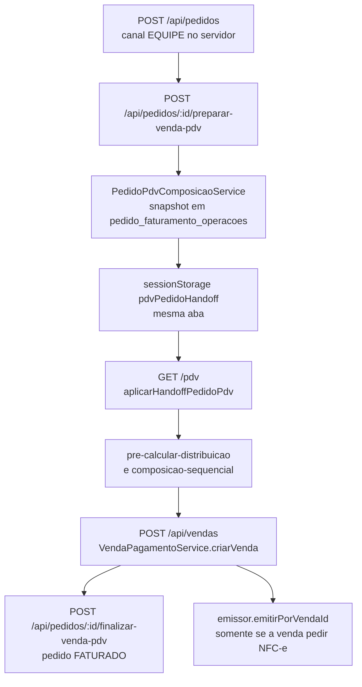

# PDV-MOBILE-01 — Auditoria do PDV Normal e do caminho até o Mobile Pedido

Leitura do código em 1º de novembro de 2026. Nenhum arquivo de produção foi alterado. Não houve venda, TEF, PIX, NFC-e nem acesso ao banco oficial.

O PDV do computador já transforma um pedido em venda. O celular ainda não entra nesse caminho. A menor implementação futura é um botão na tela do pedido que chama o contrato já usado pelo ERP e abre o mesmo `/pdv`. Não existe motivo para um segundo núcleo de vendas.

## 1. Fluxo real do PDV Normal

A página oficial é `GET /pdv`, em `backend/server.js`, com `verificarToken` e o recurso `pdv`. O arquivo servido é `frontend/pdv/index.html`. O script que conduz a venda é `frontend/pdv/js/pdv.js`. O PDV Universal (`/pdv-universal` e `/api/pdv-universal`) é outro canal e não participa deste fechamento.

Não há abertura de atendimento na venda normal. O carrinho fica na memória da página até o `POST /api/vendas`. `VendaApplicationService.concluirVendaNoNucleoOficial` chama `VendaPagamentoService.criarVenda` e o comentário do próprio serviço registra que esse caminho não chama `criarAtendimento`. O atendimento multiempresa (`AtendimentoMultiempresaService`) permanece no MUV e no PDV Universal.

| Etapa | Onde |
|---|---|
| Catálogo e carrinho | `pdv.js`, em memória |
| Prévia fiscal | `POST /api/vendas/pre-calcular-distribuicao` → `VendaPagamentoService.preCalcularDistribuicao` |
| Parcelas e recomposição | `POST /api/vendas/composicao-sequencial` → `PagamentoSequencialComposicaoService.avaliarReferenciaRecomposicao` e, quando a recomposição entra, `PagamentoRecomposicaoDocumentoService.integrarPagamentoRecomposicao` |
| Empresa do PDV | `GET /api/vendas/pdv-modelo-empresa` e `POST /api/vendas/selecao-empresa` |
| Gravação | `executarFinalizacaoVenda` → `POST /api/vendas` |
| Porta | `criarVendaComIdempotenciaPdv` → `VendaApplicationService.criarVenda` → `VendaPagamentoService.criarVenda` |
| Pedido já gravado | `POST /api/pedidos/:id/preparar-venda-pdv` e, depois da venda, `POST /api/pedidos/:id/finalizar-venda-pdv` |
| NFC-e | `VendaFiscalService.emitirFiscalSeSolicitado` → `emissor.emitirPorVendaId`; se a resposta ainda não trouxer autorização, `pdv.js` chama `POST /api/fiscal/emitir/venda/:id` |

Cliente, operador e terminal viajam no corpo e no token. A empresa da requisição vem de `X-Empresa-Id` (`CdsEmpresaContexto`), com duas travas próprias do PDV: no modo Empresa única, `PdvModeloEmpresaService` substitui `req.empresaId` por `pdv_empresa_id`; no modo várias empresas, `SelecaoEmpresaVendaPdvService` escolhe a empresa pela capacidade antes do núcleo. O cabeçalho sozinho não decide a venda.

A duplicidade da venda usa `chave_fechamento_pdv` (`pdv-${Date.now()}-…`), guardada em `pdv_fechamento_idempotencia`. Um segundo POST com a mesma chave devolve a venda já gravada. Na tela, `pdvVendaPersistida` impede outro clique de criar outra venda.

## 2. Pedido → atendimento → venda → pagamento → conclusão

O “atendimento” da venda normal é o carrinho em memória. O registro operacional anterior é o pedido.

O ERP faz isso em `frontend/erp/js/pedidos.js`, função `iniciarVendaPdv`: prepara, grava `pdvPedidoHandoff` e navega para `/pdv` na mesma aba. `aplicarHandoffPedidoPdv` só carrega o snapshot se o carrinho estiver vazio, os totais fecharem em centavos e ainda não existir `venda_id`. Os itens do snapshot entram no carrinho com quantidade, preço, desconto e subtotal congelados. O desconto e o acréscimo da tela ficam bloqueados. Na finalização, o total do carrinho tem de ser o total do snapshot; se divergir, a venda é bloqueada na própria página. O corpo segue com `origem: 'PDV'`, `pedido_id` e `pedido_faturamento_operacao_id`.

Depois do `POST /api/vendas`, `finalizarPedidoPdv` chama `finalizar-venda-pdv`. `FaturamentoService.finalizarVendaPdvPedido` só conclui se a operação for `PDV_COMPOSICAO`, da mesma empresa, com venda persistida e pagamento que não esteja `aguardando_nao_fiscal`. Se o pedido já estiver `FATURADO` com a mesma venda, a resposta é idempotente.

## 3. Motores acionados pelo fechamento

A página não recalcula a regra oficial. Ela pergunta aos serviços abaixo.

**Comercial.** O preço do pedido, na digitação, continua em `pedidos.js` (`preco_pedido`, promoção, `preco_venda`). Na passagem para o PDV, `PedidoPdvComposicaoService.prepararComposicaoPedidoPdv` relê o pedido da empresa. Pastel da categoria `PASTEIS` entra na composição com o cotador vigente (`CotacaoPrecoProdutoService` e `ComposicaoFiscalPedidoService`). Produto que não é pastel segue em passthrough, com as linhas do pedido. Tolerância, arredondamento para centavo e desconto do residual ficam nesse motor. A página do PDV ainda usa `motor-preco-atacado.js` e `valorMonetarioPdv.js` no carrinho livre; no handoff do pedido, o subtotal do snapshot prevalece.

**Estoque.** `VendaPagamentoService` usa `distribuidorEstoqueVenda`, `fiscalNaoFiscalService.separarItensDistribuidos`, `debitoEstoqueVendaViaPorta`, `leituraEstoqueEmpresaProduto`, `lotesService` (FEFO) e `pedidoReservaPonteNucleo.consumirReservasPedidoNaVenda`. A reserva criada na gravação do pedido é consumida na venda, na empresa da operação. Não há soma de saldo entre CNPJs nesse caminho.

**Financeiro.** `OrquestradorPagamento`, `VendaFinanceiroService` (soma dos pagamentos) e `tefFluxoPagamento` / `TefManager`. Dinheiro, PIX, débito, crédito, misto e prazo já saem do `executarFinalizacaoVenda`. A recomposição do documento, quando o pagamento dispara, é `PagamentoRecomposicaoDocumentoService`, chamada por `composicao-sequencial`. Confirmação pendente `aguardando_nao_fiscal` deixa o pedido aberto (`PAGAMENTO_PDV_PENDENTE`).

**Fiscal.** A distribuição F×NF é a do `distribuidorEstoqueVenda` e do pré-cálculo. A NFC-e sai de `VendaFiscalService` para `backend/services/fiscal/emissor.js`, ou do `POST /api/fiscal/emitir/venda/:id` que o PDV já faz depois do pagamento. Classificação, bloqueio e autorização continuam nesse emissor.

## 4. Contratos que o celular pode reutilizar

| Contrato | Uso |
|---|---|
| `POST /api/pedidos` | Já usado por `/mobile-pedido`. Canal `EQUIPE` no servidor |
| `POST /api/pedidos/:id/preparar-venda-pdv` | Monta o snapshot e a operação `PDV_COMPOSICAO` |
| `sessionStorage.pdvPedidoHandoff` | Entrega o snapshot ao `/pdv` na mesma aba |
| `POST /api/vendas` | Persiste a venda, com `chave_fechamento_pdv`, `pedido_id` e `pedido_faturamento_operacao_id` |
| `POST /api/vendas/pre-calcular-distribuicao` | Distribuição antes de gravar |
| `POST /api/vendas/composicao-sequencial` | Conferência das parcelas e da recomposição |
| `POST /api/pedidos/:id/finalizar-venda-pdv` | Liga o pedido à venda e marca `FATURADO` |
| `POST /api/fiscal/emitir/venda/:id` | NFC-e depois da venda, pelo fluxo que o PDV já tem |
| `CdsEmpresaContexto` e `X-Empresa-Id` | Empresa da sessão |
| Caixa aberto | `validarCaixaSeOrigemPdv` no `POST /api/vendas` |

O pedido recém-gravado no celular devolve `id` e `codigo` na tela de confirmação (`mobile-pedido.js`, estado `confirmacao`). Esse `id` é o que `iniciarVendaPdv` já envia. A página mobile hoje não chama preparação nem `/pdv`.

## 5. Encaminhamento seguro do pedido mobile

O mesmo navegador, na mesma aba:

1. `POST /api/pedidos/:id/preparar-venda-pdv` com o token e `X-Empresa-Id` da empresa do pedido.
2. Se `venda_concluida` ou se já houver `venda_id`, não abrir outro carrinho. O ERP chama `finalizar-venda-pdv` ou avisa que a venda existe.
3. Guardar o JSON em `pdvPedidoHandoff` e ir para `/pdv`.
4. O PDV carrega o snapshot, cobra e grava em `/api/vendas`.
5. O vínculo final é `finalizar-venda-pdv`.

`prepararOperacaoPdv` só aceita pedido `PEDIDO`, `ABERTO` ou `EM_SEPARACAO`, da mesma empresa. Cancelado, faturado ou com venda já apontada é recusado. Uma segunda preparação reutiliza a operação; não cria outra. Na gravação, `obterVendaExistenteDaOperacaoPedido` exige o mesmo `pedido_id`, a mesma empresa, o mesmo total e os mesmos itens do snapshot (`COMPOSICAO_PDV_DIVERGENTE` ou `FATURAMENTO_PEDIDO_CONFLITANTE`). Venda de outra empresa não vincula.

O `sessionStorage` não atravessa aparelhos. O computador não recebe sozinho o pedido que o celular gravou. Quem for vender no caixa continua podendo usar o botão já existente na listagem do ERP.

## 6. O que a interface pode reutilizar

- `iniciarVendaPdv` e `aplicarHandoffPedidoPdv`, sem copiar a montagem do snapshot.
- `executarFinalizacaoVenda`, `pagamentoSequencial.js`, `interacaoPagamentoMisto.js`, `tefFluxoPagamento.js`, `valorMonetarioPdv.js` e `motor-preco-atacado.js`.
- `CdsEmpresaContexto`, login e `X-Empresa-Id`.
- A tela de confirmação de `/mobile-pedido`, que já tem o código do pedido e deixa claro que ainda não é venda.

`/pdv` é a página de computador: barra lateral, Bootstrap e dezenas de campos (`#descontoPdv`, `#formaPagamentoPdv`, carrinho). Ela cabe no navegador do celular, mas não é uma interface mobile-first. `executarFinalizacaoVenda` lê esses campos. Uma página nova que remontasse o JSON da venda estaria reescrevendo o fechamento.

## 7. Lacunas para um PDV no celular

- `/mobile-pedido` não tem ação de encaminhar ao PDV.
- O layout de `/pdv` não foi feito para toque nem para tela estreita.
- O fechamento está preso ao DOM dessa página. Não há uma função pura, sem tela, que o celular possa chamar.
- TEF e impressão do cupom dependem da estação Electron e do equipamento ligado a ela. O navegador do celular não substitui o pinpad.
- A venda exige caixa aberto na origem PDV. Sem caixa, `/api/vendas` não conclui.
- No modo Empresa única, a venda usa `pdv_empresa_id`, não a empresa que o celular escolheu. Se forem diferentes, a conferência do snapshot bloqueia. Isso é proteção, não transferência de saldo.
- A composição de pastel pode gerar linhas diferentes das que o operador viu no pedido. O celular tem de mostrar o snapshot devolvido por `preparar-venda-pdv`, não repetir o carrinho cru.

## 8. Duplicidade, concorrência e empresas

- Uma operação `PDV_COMPOSICAO` por pedido, em transação `BEGIN IMMEDIATE`.
- `chave_fechamento_pdv` e `pdvVendaPersistida` impedem a segunda venda do mesmo fechamento.
- O snapshot é conferido de novo no servidor antes de aceitar os itens.
- Pedido cancelado ou já faturado não inicia outra venda.
- Pagamento não fiscal pendente não marca o pedido como faturado.
- A baixa e a reserva usam a empresa da operação. Estoque de outro CNPJ não entra na conta.
- Se a seleção automática do PDV apontar outra empresa, a venda do pedido é recusada pelo confronto `empresa_id`. Não se corrige isso somando saldos.

## 9. Testes

Sequência `node --test --test-concurrency=1`. Banco em memória ou leitura de fonte. Sem `ProgramData`, sem venda real, sem TEF e sem SEFAZ.

| Arquivo | Resultado |
|---|---|
| `tests/vendas/pedido-pdv-composicao.test.js` | 19 passaram. Composição, passthrough, bloqueio sem item elegível e preço vigente |
| `tests/pdv/cds-pdv-valor-pasteis-02.test.js` | 10 passaram. Handoff oficial e preservação da empresa do pedido |
| `tests/faturamento/sprint35-pedidos-ui.test.js` | 5 passaram. A listagem do ERP já oferece gerar e recuperar a venda no PDV |

Nenhuma falha nova deste escopo. As falhas antigas de estoque do pedido, unidade da mesa e coluna de ficha técnica não foram reexecutadas nem corrigidas.

## 10. Menor implementação

Um botão na confirmação de `/mobile-pedido`, na mesma aba: `POST /api/pedidos/:id/preparar-venda-pdv`, gravar `pdvPedidoHandoff` e abrir `/pdv`. É o que `iniciarVendaPdv` já faz. A venda, o pagamento, o estoque, a recomposição e a NFC-e continuam nos serviços atuais.

Não criar página de fechamento paralela, não copiar `executarFinalizacaoVenda`, não abrir o PDV Universal e não emitir NFC-e direto do celular. Uma casca mobile-first só cabe depois, se ela chamar as mesmas funções e os mesmos endpoints, sem outro cálculo de preço, estoque ou fiscal.

## Estado

| Estado | Situação |
|---|---|
| CONCLUÍDO | O caminho pedido → PDV → venda está localizado no código e no contrato HTTP |
| TESTADO | 34 testes isolados do contrato e da composição, sem banco oficial |
| HOMOLOGADO | Não. Não houve venda no celular nem no caixa |
| BLOQUEADO | PDV operado pelo celular. Esta auditoria não implementa essa tela |
