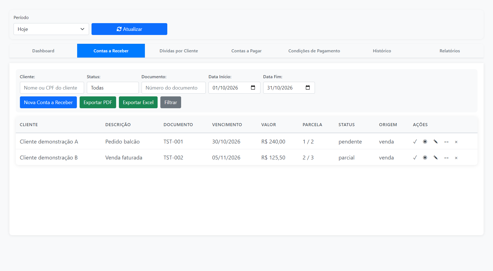
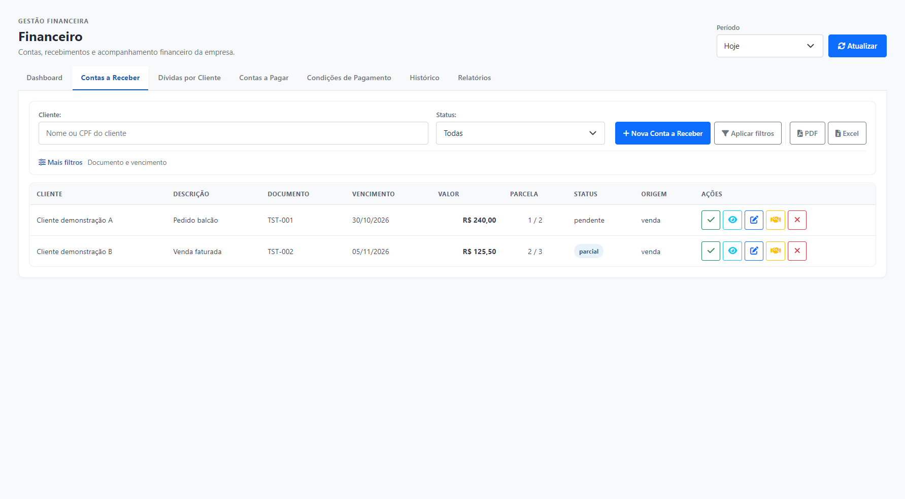
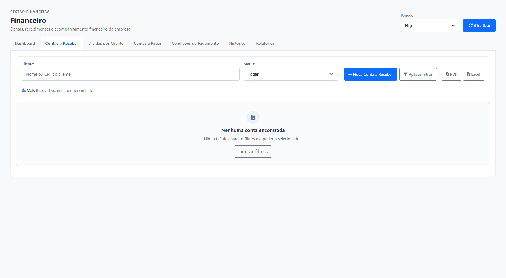

# Sprint FIN-UX-01 — Relatório da primeira entrega visual

**Projeto:** CDS Sistemas  
**Escopo entregue:** estrutura compartilhada do Financeiro e aba Contas a Receber  
**Data:** 25/10/2026  
**Status:** implementação e validação visual inicial concluídas; homologação do Tech Lead pendente.

## 1. Arquivos alterados

- `frontend/erp/pages/financeiro.html` — novo cabeçalho compacto, período organizado e navegação horizontal acessível; sete abas mantidas.
- `frontend/css/financeiro.css` — estilos compartilhados do shell e estilos específicos de filtros, tabela, status e estado vazio de Contas a Receber. Usa variáveis existentes do CDS UI Foundation; não cria uma folha de estilos paralela.
- `frontend/erp/js/financeiro-receber.js` — reorganização do markup de filtros e tabela, expansão dos filtros avançados, estado vazio com limpeza, rótulos acessíveis para ações e validação explícita do formato/HTTP da resposta da API.
- `docs/financeiro/SPRINT-FIN-UX-01-ANTES.png` — captura de referência da estrutura e CSS anteriores.
- `docs/financeiro/SPRINT-FIN-UX-01-DEPOIS.png` — captura da tela redesenhada com dados sintéticos.
- `docs/financeiro/SPRINT-FIN-UX-01-ESTADO-VAZIO.png` — captura do estado sem resultados.
- `tests/financeiro/fin-ux-01-electron-preview.js` — teste visual isolado e repetível no Electron, com servidor estático local, mock de API e verificações de layout.

O teste visual não inicializa backend nem banco; usa apenas assets servidos em loopback e dados sintéticos.

## 2. Decisões de layout

- O título e a descrição ficam alinhados à esquerda; período e atualização ficam compactos à direita.
- As sete abas usam navegação horizontal de altura reduzida. Em larguras menores, a navegação pode rolar sem transformar as abas em blocos altos.
- Contas a Receber prioriza cliente e status. Documento e intervalo de vencimento ficam em “Mais filtros”, recolhível.
- A criação permanece como ação primária; aplicar filtros e exportações são secundárias. As duas exportações continuam disponíveis.
- A tabela tem cabeçalho e linhas mais densos, valor alinhado à direita, parcela centralizada, etiquetas semânticas de status e ações agrupadas com rótulos acessíveis.
- Sem resultados, a tabela é substituída por um estado vazio compacto com opção de limpar filtros.
- Erros de resposta não são apresentados como lista vazia: a interface mantém o estado de erro visível e registra a falha no console.

## 3. Capturas antes/depois

As capturas foram feitas no Electron, na mesma janela de **1440 × 900**. O viewport do renderer reportado foi **1426 × 787**; os arquivos PNG, considerando a escala de tela, têm **1783 × 984**. A referência anterior usa a marcação e o CSS anteriores, com os mesmos dados sintéticos demonstrativos.

### Antes

### Depois

### Estado vazio

Os registros das capturas são fictícios (`TST-001` e `TST-002`); nenhum dado de cliente foi utilizado.

## 4. Comportamento e contratos preservados

- O endpoint continua sendo `GET /api/financeiro/receber`.
- Os parâmetros mantêm os nomes existentes: `cliente`, `status`, `documento`, `dataInicio` e `dataFim`.
- O helper existente de cabeçalhos continua sendo usado; não foi removido nem substituído o contexto `X-Empresa-Id`.
- Foram preservados os nomes das ações de criar, filtrar, exportar, baixar, abrir detalhes, editar, renegociar e cancelar.
- Não foram alteradas permissões, cálculos financeiros, regras de recebimento, rotas ou contratos do backend.
- A resposta esperada da rota, já presente no código, deve conter `success: true` e `contas` como array. Respostas HTTP inválidas ou fora desse contrato agora apresentam erro em vez de serem tratadas como estado vazio.
- A paginação não foi introduzida; a tela de origem não possuía paginação neste componente.

## 5. Testes e resultados

### Sintaxe e regressões

- `node --check frontend\erp\js\financeiro-receber.js` — aprovado.
- `node --check electron-erp.js` — aprovado.
- `node tests\financeiro\fin-p1-2-consistencia.test.js` — **4 aprovados, 0 falhas**.
- `node tests\financeiro\contexto-empresarial-financeiro-p0.test.js` — **6 aprovados, 0 falhas**.
- `node_modules\.bin\electron.cmd tests\financeiro\fin-ux-01-electron-preview.js` — aprovado; verificações de abas, registros, ações, filtro, cabeçalho empresarial, estado vazio, erro de API e overflow responsivo passaram.
- `git diff --check` nos três arquivos de interface — aprovado.

### Interface

Executado harness isolado no Electron com respostas sintéticas; nenhum servidor backend, banco ou endpoint real foi iniciado ou consultado.

- Contas a Receber renderizou dois registros, manteve as sete abas e apresentou dez ações de linha.
- Filtros avançados preservaram os parâmetros enviados à API.
- O helper de autenticação/contexto foi exercitado com `X-Empresa-Id: empresa-sintetica`.
- A limpeza removeu o filtro de documento e restaurou os filtros padrão do período.
- A resposta vazia mostrou o estado vazio e ocultou a tabela.
- Uma resposta de erro não foi convertida em estado vazio; a interface mostrou mensagem de erro.
- Foram verificadas larguras de janela de 1440, 1024 e 768 px. O documento não apresentou rolagem horizontal global; a tabela continua responsiva dentro de sua área.

## 6. Regressões, limitações e pendências

- **Regressões funcionais encontradas:** nenhuma nos testes executados.
- **Limitação de integração:** a validação Electron usou a tela e o renderer reais, em uma janela de teste com estilos reais e API mockada. Não foi feito login nem iniciado o ERP completo com backend.
- **Escopo visual:** as demais abas receberam apenas a nova estrutura compartilhada de cabeçalho e navegação. Seus conteúdos internos não foram redesenhados.
- **Homologação:** a implementação está pronta para avaliação do Tech Lead; não equivale à aprovação final da Sprint.
- **Próximo passo:** homologar esta tela antes de ampliar o padrão para outras abas.

Nenhuma regra financeira foi modificada e nenhum dado persistente foi usado ou alterado.
