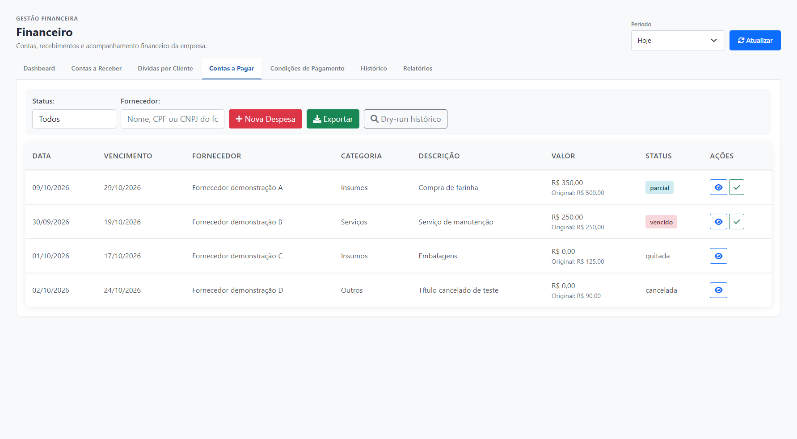
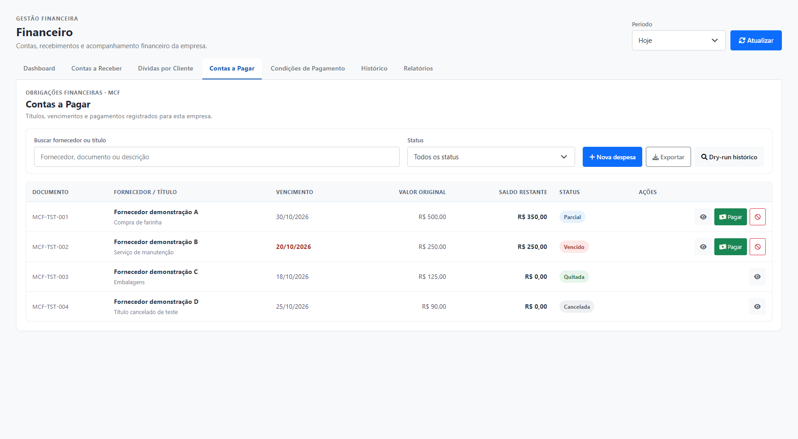
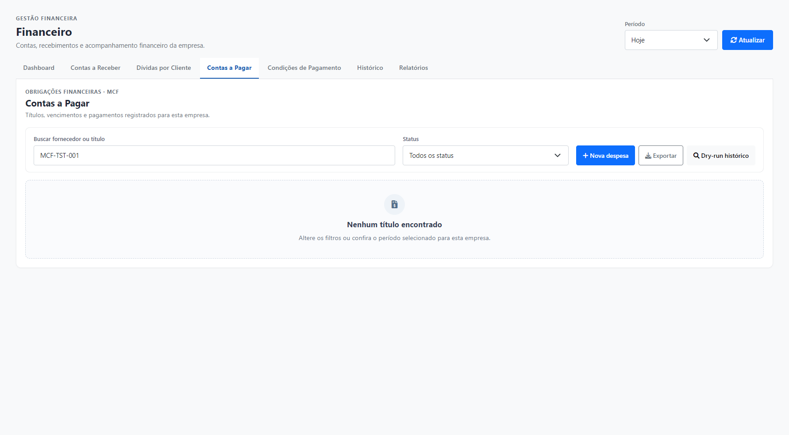

# Sprint FIN-UX-02 — Redesign de Contas a Pagar

**Projeto:** CDS Sistemas  
**Escopo:** conteúdo da aba Contas a Pagar  
**Data:** 25/10/2026  
**Status:** implementação e validação visual isolada concluídas; homologação do Tech Lead pendente.

## 1. Diagnóstico e arquivos

O renderer já consultava a rota canônica `GET /api/contas-pagar` e exibia títulos MCF, porém usava filtros e tabela genéricos. O valor restante aparecia como valor principal com o original em texto auxiliar; documento e saldo não tinham colunas próprias. A ausência de resultados e o carregamento ocupavam a tabela, e falhas apareciam como linha de tabela. A resposta HTTP bem-sucedida sem `{ success: true, contas: [...] }` era tratada como lista vazia. Detalhes e pagamentos estavam disponíveis; o cancelamento administrativo ocorria no detalhe. A inspeção da captura também confirmou que datas sem horário eram convertidas de UTC para horário local, exibindo o dia anterior.

Arquivos alterados/criados:

- `frontend/erp/js/financeiro-pagar.js` — reorganização exclusiva do conteúdo da aba, renderização dos estados, apresentação dos campos MCF e exibição local correta de datas sem horário.
- `frontend/css/financeiro.css` — estilos específicos de Contas a Pagar, adicionados à folha compartilhada existente.
- `tests/financeiro/fin-ux-02-electron-preview.js` — harness Electron isolado para registros sintéticos, ações, permissões, estados e responsividade.
- `docs/financeiro/SPRINT-FIN-UX-02-RELATORIO.md` — este relatório.
- `docs/financeiro/SPRINT-FIN-UX-02-ANTES.png`, `SPRINT-FIN-UX-02-DEPOIS.png` e `SPRINT-FIN-UX-02-ESTADO-VAZIO.png` — capturas Electron antes/depois e do estado vazio.

`frontend/erp/pages/financeiro.html` não precisou de alterações. A estrutura compartilhada aprovada na FIN-UX-01 e todas as sete abas foram preservadas.

## 2. Decisões visuais e funcionais

- Cabeçalho interno compacto identifica a área como obrigações MCF, com contexto curto.
- Filtros de fornecedor/título e status ficam organizados antes das ações. Os mesmos campos, valores e parâmetros foram mantidos.
- A ação de criação é primária; exportação e dry-run são secundárias.
- A tabela apresenta documento, fornecedor/título, vencimento, valor original, saldo restante, status e ações. Os valores vêm dos campos retornados pelo serviço MCF; texto de fornecedor/descrição/documento é escapado na renderização.
- Valores ficam alinhados à direita com algarismos tabulares. Status têm etiquetas semânticas; vencimento atrasado é destacado sem alterar o estado persistido.
- Pagamento é mostrado apenas para títulos abertos/parciais. Cancelamento controlado aparece na linha somente para administradores e títulos abertos/parciais; continua usando a função MCF existente, que pede motivo e confirmação. Detalhes permanecem disponíveis. Não foram adicionadas ações de editar ou excluir título.
- Carregamento, erro e lista vazia têm apresentações distintas. Respostas inválidas não são convertidas em sucesso vazio; a falha é exibida e registrada no console.
- Datas no formato `YYYY-MM-DD` são formatadas como datas civis locais, sem deslocamento de um dia; valores com horário continuam no caminho de formatação existente.
- **Indicadores agregados não foram incluídos.** A listagem é filtrável e limitada a até 500 títulos; somar ou contar apenas o resultado carregado poderia sugerir totais financeiros incompletos.

## 3. Contratos e regras preservados

- Fonte de listagem: `contas_pagar` pela rota MCF existente. Nenhuma soma de projeções legadas de `financeiro` foi introduzida.
- Filtros mantidos: `dataInicio`, `dataFim`, `status` e `fornecedor`.
- Cabeçalhos empresariais continuam passando pelo helper existente `headersAuthPagar`/`CdsEmpresaContexto`; o harness confirmou `X-Empresa-Id`.
- Pagamento continua usando `GET /api/contas-pagar/:id/detalhes` e `POST /api/contas-pagar/:id/baixar`, com valor, forma de pagamento e chave `Idempotency-Key`.
- Cancelamento continua usando `POST /api/contas-pagar/:id/cancelar`, motivo, confirmação e chave de idempotência. O backend segue responsável pela autorização e consistência.
- Exportação, formulário de criação, consulta de detalhes, histórico de pagamentos e atualização de Dashboard existente não tiveram seus contratos alterados.
- Nenhum endpoint, arquivo de backend, regra de cálculo, banco, migração ou dado persistente foi modificado.

## 4. Capturas e validação visual

As capturas foram produzidas no Electron, no mesmo tamanho de janela (**1440 × 900**), com dados sintéticos. Os arquivos PNG têm **1783 × 984 px** em ambas as capturas comparativas. O renderer observado no Electron reportou viewport **1426 × 787 px**.

### Antes

### Depois

### Estado vazio

O harness também verificou larguras de janela solicitadas de **1440, 1024 e 768 px** (viewports de 1426, 1010 e 754 px). Não houve overflow horizontal global. A tabela mantém rolagem horizontal interna nas larguras em que seu conteúdo mínimo excede a área disponível.

## 5. Testes executados

- `node --check frontend\erp\js\financeiro-pagar.js` — aprovado.
- `node --check tests\financeiro\fin-ux-02-electron-preview.js` — aprovado.
- `git diff --check` nos arquivos desta entrega — aprovado.
- `node_modules\.bin\electron.cmd tests\financeiro\fin-ux-02-electron-preview.js` — aprovado:
  - sete abas preservadas e quatro títulos sintéticos renderizados;
  - colunas, filtros, período e `X-Empresa-Id` verificados;
  - ação de cancelamento visível apenas para administrador e títulos ativos;
  - pagamento de R$ 150,00 reduziu o saldo de R$ 350,00 para R$ 200,00; pagamento subsequente de R$ 200,00 quitou o saldo simulado;
  - payloads de baixa/cancelamento e chaves de idempotência foram inspecionados;
  - estados de carregamento, vazio e erro verificados;
  - data civil `2026-10-30` exibida como `30/10/2026`, sem deslocamento UTC/local;
  - telas verificadas em 1440, 1024 e 768 px sem overflow global.
- `node --test tests\financeiro\mcf-01.test.js` — **17 aprovados, 0 falhas**, incluindo baixa parcial, quitação, excesso, cancelamento parcial, idempotência e isolamento.
- `node tests\financeiro\contexto-empresarial-financeiro-p0.test.js` — **6 aprovados, 0 falhas**, incluindo cabeçalho e isolamento MULTIEMPRESA.
- `node tests\financeiro\fin-p1-2-consistencia.test.js` — **4 aprovados, 0 falhas**.

O teste Electron emite no console a falha sintética intencional do caso de erro; a interface a apresenta como erro, não como estado vazio. Isso não representa falha de regressão.

## 6. Limitações e pendências

- A validação visual/funcional de interface usou o renderer real, estilos reais e respostas simuladas em servidor loopback. Não iniciou login, backend ou banco do ERP; portanto, as operações de pagamento e cancelamento no harness validam a chamada e apresentação da interface, não executam liquidações reais.
- Os testes MCF/MULTIEMPRESA executados usam bancos SQLite isolados e cobrem as regras e o contexto empresariais pertinentes. Não foram usados dados reais nem o banco original.
- Não foi realizada validação de integração autenticada ponta a ponta.
- Nenhuma regressão foi identificada nos testes executados. A homologação final permanece a cargo do Tech Lead.

**Confirmação:** sem alteração persistente ou migração; MCF, MULTIEMPRESA e contratos de API foram preservados. A entrega termina nesta aba e aguarda homologação antes de qualquer expansão visual.
