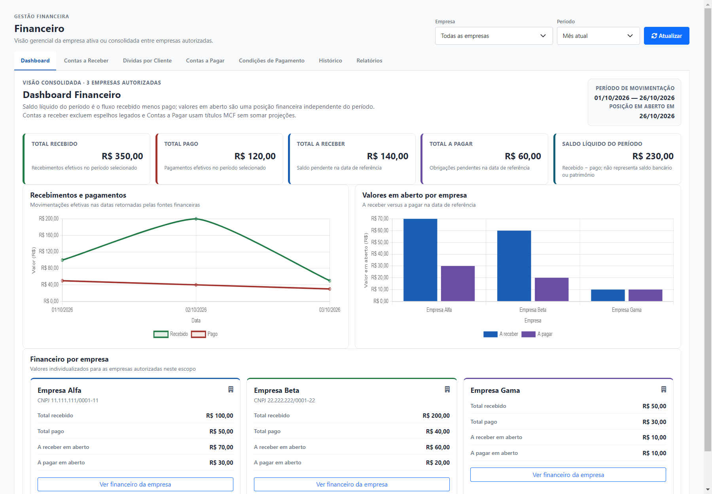

# FIN-UX-08 — Dashboard Financeiro Multiempresa

## Resumo

Implementada uma visão financeira consolidada para as empresas autorizadas ao usuário e uma visão individual selecionável por empresa. A consolidação e a seleção individual usam a mesma resposta agregada no backend, sem confiar em uma lista de empresas enviada pelo frontend. O endpoint individual existente foi preservado.

## Arquivos alterados

- `backend/rotas/financeiro.js` — novo endpoint multiempresa e agregação por empresa.
- `frontend/erp/js/financeiro.js` — carregamento da lista oficial de empresas, seletor global, sincronização com contexto empresarial e bloqueio das abas operacionais no escopo consolidado.
- `frontend/erp/js/financeiro-dashboard.js` — resumo, gráficos, cards, tratamento de erros e prevenção de respostas obsoletas.
- `frontend/erp/pages/financeiro.html` — seletor global de empresa.
- `frontend/css/financeiro.css` — estilos do seletor, indicadores, gráficos e cards responsivos.
- `tests/financeiro/fin-ux-08-multiempresa.test.js` — testes backend com SQLite `:memory:`.
- `tests/financeiro/fin-ux-08-electron-preview.js` — testes de interface com respostas sintéticas e captura.
- `docs/financeiro/SPRINT-FIN-UX-08-RELATORIO.md` — este relatório.
- `docs/financeiro/SPRINT-FIN-UX-08-DEPOIS.png` — captura sintética do dashboard.

## Endpoints e fontes

- `GET /api/financeiro/dashboard` continua sendo o endpoint individual existente, sem alteração de contrato.
- `GET /api/financeiro/dashboard/multiempresa` é o novo endpoint. Aceita `empresaId=todas` ou um único `empresaId`, além de `dataInicio` e `dataFim`. Retorna `empresas`, `resumo`, `serieTemporal`, `periodo` e o escopo efetivamente consultado.
- A lista de empresas vem de `UsuarioEmpresaService.listarEmpresasPermitidas`, que aplica os vínculos empresariais autorizados e empresas ativas. O frontend usa `CdsEmpresaContexto.listarDisponiveis`; IDs recebidos são novamente validados no backend. Uma seleção não autorizada retorna 403 antes de consultar fontes financeiras.
- O endpoint agrega o histórico de `financeiro`, os pagamentos de `contas_receber_pagamentos` relacionados a `contas_receber`, os pagamentos de `contas_pagar_pagamentos` e os saldos em aberto de `contas_receber` e `contas_pagar`.
- Para recebíveis legados, são reutilizadas as regras oficiais de exclusão de venda cancelada e de espelho de recebível canônico. Para Contas a Pagar, a exclusão existente de projeções MCF é preservada; os títulos canônicos e seus pagamentos são obtidos de `contas_pagar` e `contas_pagar_pagamentos`.
- As junções de Contas a Receber com vendas exigem empresa coincidente. As consultas financeiras são filtradas pelo conjunto autorizado derivado no servidor; nenhuma lista arbitrária enviada pelo cliente é usada como autorização.

## Regras dos indicadores

- **Total recebido:** soma das receitas legadas liquidadas elegíveis e dos pagamentos efetivos dos títulos canônicos de Contas a Receber no período. A data de referência para o histórico legado segue a regra já usada pelo dashboard individual (`COALESCE(vencimento, data_movimento)`); pagamentos canônicos usam `data_pagamento`.
- **Total pago:** soma das despesas históricas liquidadas elegíveis e dos pagamentos canônicos de Contas a Pagar no período. Despesas históricas seguem a mesma data-base legada do dashboard individual; pagamentos canônicos usam `data_pagamento`.
- **A receber:** posição em aberto na data de referência, sem recorte pelo período de movimentação: recebíveis legados elegíveis mais títulos canônicos abertos ou parciais, descontando os saldos já pagos e excluindo espelhos e vendas canceladas conforme as regras existentes.
- **A pagar:** posição em aberto na data de referência: obrigações históricas elegíveis mais títulos canônicos de Contas a Pagar abertos ou parciais. Projeções MCF não são somadas como obrigações adicionais.
- **Saldo líquido do período:** total recebido menos total pago no período. É um fluxo líquido gerencial; não representa saldo bancário, caixa disponível ou patrimônio.
- A série temporal contém somente datas com movimentação retornada pelas fontes; não preenche dias sem movimento nem inventa percentuais. A data de referência da posição em aberto é explicitada na resposta e na interface.

## Interface e comportamento

- O seletor inicia em “Todas as empresas” e oferece somente as empresas retornadas pelo contexto empresarial oficial.
- Selecionar uma empresa sincroniza o contexto compartilhado. A troca atualiza o dashboard e preserva o período selecionado; identificadores de requisição impedem que respostas antigas substituam a seleção atual.
- “Todas as empresas” mostra o consolidado e um card para cada empresa autorizada. As abas operacionais individuais não apresentam silenciosamente dados de uma única empresa neste escopo; exibem um aviso até que uma empresa seja selecionada.
- Cada card apresenta nome, CNPJ quando disponível, os valores por empresa e a ação “Ver financeiro da empresa”. Dados dinâmicos de texto são escapados antes da renderização.
- Falha de autorização ou de qualquer fonte financeira é apresentada como erro. O endpoint não retorna resumo parcial como se fosse completo, e a interface não substitui erro por valores zero.

## Testes e resultados

### Testes backend e regressões focadas

Comando:

```text
node --test tests\financeiro\fin-ux-08-multiempresa.test.js tests\financeiro\fin-int-12-leituras-receber.test.js tests\financeiro\fin-int-13-escritas-receber.test.js tests\financeiro\sprint-2-3-1-recebimentos-integrados.test.js tests\financeiro\contexto-empresarial-financeiro-p0.test.js
```

Resultado: **20 testes aprovados, 0 falhas**. As fixtures do endpoint usam SQLite `:memory:` e cobrem três empresas autorizadas, usuário com escopo restrito, seleção individual, soma individual/consolidada, período, não duplicação legado/CR e MCF/projeções, bloqueio de acesso não autorizado antes de consultas financeiras, e falha de fonte sem resposta parcial. As regressões FIN-INT-12, FIN-INT-13, recebimentos integrados e contexto empresarial P0 também passaram.

### Interface Electron

Comando:

```text
node_modules\.bin\electron.cmd tests\financeiro\fin-ux-08-electron-preview.js
```

Resultado: aprovado. A verificação cobriu seleção inicial consolidada, alternância para cada empresa, cabeçalho e contexto ativo, preservação do período, botão do card, navegação entre abas, falha HTTP e conteúdo dos gráficos. A validação responsiva não encontrou overflow horizontal:

- 1440 px: cinco indicadores em cinco colunas e dois gráficos lado a lado.
- 1024 px: duas colunas de indicadores e gráficos empilhados.
- 768 px: uma coluna de indicadores e gráficos empilhados.

A captura usa exclusivamente empresas e valores sintéticos; o CNPJ foi apresentado formatado.

### Sintaxe

`node --check` passou para:

- `backend/rotas/financeiro.js`
- `frontend/erp/js/financeiro-dashboard.js`
- `frontend/erp/js/financeiro.js`
- `tests/financeiro/fin-ux-08-multiempresa.test.js`
- `tests/financeiro/fin-ux-08-electron-preview.js`

## Captura



## Limitações e itens não verificados

- As consultas legadas preservam a semântica de período do dashboard individual, que usa `COALESCE(vencimento, data_movimento)` para receitas e despesas liquidadas. Os pagamentos canônicos usam a data de pagamento. Não foi alterada a regra temporal legada nesta sprint.
- O modo consolidado apresenta o Dashboard e seus cards; as abas operacionais seguem individuais e exigem selecionar uma empresa. Não foi criada uma visão operacional consolidada.
- A captura é de preview Electron com respostas sintéticas, não de ambiente de produção. Não foi executado teste amplo da aplicação nem verificação visual com dados reais.
- O layout aprovado mencionado no pedido não estava anexado ao ambiente; a implementação usou a referência visual já existente no repositório.
- Não foram alterados contratos financeiros existentes além da adição do endpoint multiempresa. Nenhuma migração ou backfill foi executado.

## Segurança e encerramento

Todos os testes com banco utilizaram SQLite `:memory:`; o preview usou fixtures sintéticas. Nenhum banco oficial ou de cliente foi acessado ou modificado. Não foram executados pagamentos, baixas, cancelamentos, devoluções, conciliações ou eventos fiscais, e nenhuma migração ou backfill foi realizado.

FIN-UX-08 concluída. Aguardando homologação do Tech Lead; nenhuma outra sprint foi iniciada.
