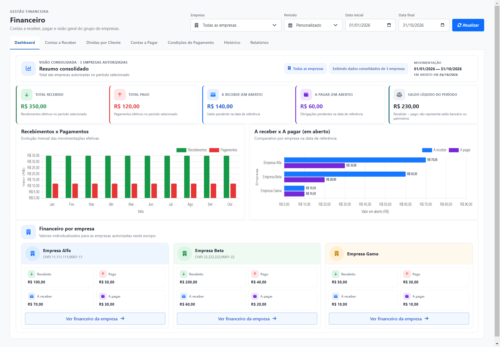
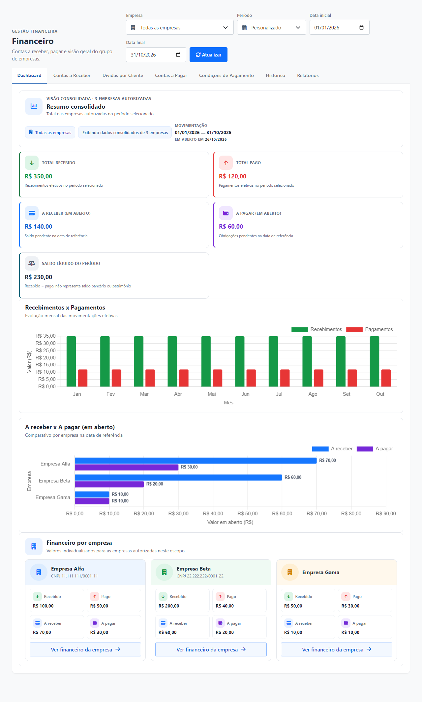
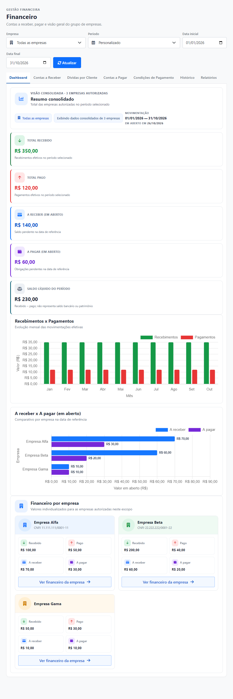

# FIN-UX-09 — Fidelidade visual do Dashboard Financeiro Multiempresa

## Resumo

O Dashboard foi ajustado para se aproximar da referência aprovada, preservando a seleção consolidada/individual, a autorização empresarial e as regras financeiras da FIN-UX-08. O diagnóstico confirmou que os dois defeitos relatados eram de apresentação e granularidade visual; não foi necessária alteração no endpoint nem nas consultas financeiras.

## Causa dos problemas dos gráficos

### Recebimentos e pagamentos

`GET /api/financeiro/dashboard/multiempresa` retorna `serieTemporal` ordenada por data e agrupada por dia. O frontend anterior usava cada data como categoria e desenhava uma linha. Assim, uma única data com movimento resultava corretamente em um ponto diário, mas não apresentava a evolução mensal solicitada.

A consulta não inventa datas nem preenche períodos sem movimento. A implementação agora agrega somente as datas recebidas em seus respectivos meses e usa barras agrupadas. Um mês aparece apenas se houver ao menos uma data na série; múltiplas datas do mesmo mês são somadas. Se não houver movimentação efetiva, ou todos os valores forem zero, o gráfico é substituído pelo estado “Sem movimentações no período”. A série vazia ou incompleta não é convertida em valores fictícios.

Não foi acessado banco de produção, portanto não é possível confirmar quantas datas de movimento existem na base real ou atribuir a ela o caso observado de um único ponto. A granularidade diária do contrato e o comportamento visual foram confirmados pelo código e por fixtures isoladas.

### Valores em aberto

O gráfico anterior era vertical e deixava o Chart.js escolher automaticamente a escala. Um teste Electron isolado confirmou que uma série composta apenas por zero, com `beginAtZero`, recebia escala máxima 1. Essa expansão explica a escala visual de R$ 0,00 a R$ 1,00 apesar dos valores zerados.

Agora, quando todos os saldos estão zerados, não se desenha um eixo positivo artificial: é exibido “Nenhum saldo em aberto”. Com valores presentes, o comparativo usa barras horizontais agrupadas por empresa, escala e tooltips em reais e rótulos monetários nas barras.

## Arquivos alterados

- `frontend/erp/js/financeiro-dashboard.js` — agrupamento mensal da série diária existente, barras agrupadas, comparativo horizontal, rótulos em reais, validação de datas e estados vazios.
- `frontend/erp/pages/financeiro.html` — subtítulo e ícones de prédio/calendário nos seletores do cabeçalho.
- `frontend/css/financeiro.css` — hierarquia visual, ícones e cores semânticas dos cinco indicadores, gráficos, cabeçalhos e cards empresariais responsivos.
- `tests/financeiro/fin-ux-08-electron-preview.js` — cenários de gráficos, estados vazios, validação de respostas e capturas responsivas FIN-UX-09.
- `docs/financeiro/SPRINT-FIN-UX-09-RELATORIO.md` — este relatório.
- `docs/financeiro/SPRINT-FIN-UX-09-1440.png` — captura sintética em viewport lógico de 1440 px.
- `docs/financeiro/SPRINT-FIN-UX-09-1024.png` — captura sintética em viewport lógico de 1024 px.
- `docs/financeiro/SPRINT-FIN-UX-09-768.png` — captura sintética em viewport lógico de 768 px.

`backend/rotas/financeiro.js` não foi alterado: a consulta já retornava movimentos por dia, empresas, resumos e saldos em aberto com os filtros e exclusões esperados. A causa comprovada estava na configuração e no mapeamento visual do frontend.

## Correções visuais

- Cabeçalho com título e subtítulo, seletor de empresa com ícone de prédio, período com ícone de calendário, botão azul “Atualizar” e abas preservadas.
- Resumo com cinco cards em uma linha em telas largas; cada indicador recebeu ícone em fundo suave, borda semântica, rótulo discreto e valor destacado. O saldo continua identificado como líquido do período.
- Gráfico “Recebimentos x Pagamentos” com barras agrupadas por mês, recebimentos verdes, pagamentos vermelhos, legenda no topo e escala monetária em reais.
- Gráfico “A receber x A pagar (em aberto)” com barras horizontais por empresa, séries azul/roxa, nomes legíveis e valores em reais.
- Cards empresariais com cabeçalho colorido suave, ícone, nome, CNPJ quando disponível, grade de duas colunas para os quatro valores e botão de destaque azul.
- O número de cards continua vindo da resposta de empresas autorizadas. A referência ilustra quatro empresas; o preview sintético mostra três, sem acrescentar uma quarta empresa fictícia à aplicação.
- Falhas HTTP e respostas inválidas continuam ocultando os dados e apresentando erro; valores `null` na série são rejeitados, não convertidos em zero.

## Comparação objetiva com a referência

- **Cabeçalho:** foram aproximados título, subtítulo, ícones dos seletores, botão azul e navegação por abas.
- **Resumo:** os cinco indicadores agora usam ícones coloridos e as cores semânticas de recebimento, pagamento, contas a receber, contas a pagar e saldo.
- **Gráficos:** a visualização diária em linha foi substituída por barras mensais agrupadas; o comparativo vertical passou a horizontal e ganhou rótulos monetários.
- **Empresas:** cabeçalhos com fundos suaves, métricas em duas colunas e ações azuis reproduzem a hierarquia do exemplo. A contagem continua dinâmica; a captura contém os três registros sintéticos autorizados pelo fixture.
- **Diferenças deliberadas:** a quantidade de empresas não é fixada em quatro; não foram copiados os números da imagem. As capturas usam dados sintéticos de teste. O saldo permanece “Saldo líquido do período”, coerente com a definição financeira já aprovada, e não é rotulado como saldo bancário.

## Testes e resultados

### Preview Electron e gráficos

Comando:

```text
node_modules\.bin\electron.cmd tests\financeiro\fin-ux-08-electron-preview.js
```

Resultado: aprovado. O preview verificou:

- várias datas distribuídas em meses distintos e agregação de múltiplas datas do mesmo mês;
- rótulos, cores e tipo de gráfico mensal; série com dez meses sintéticos usada somente para as capturas;
- uma empresa sem movimentação, sem criar meses ou pontos para ela;
- resposta sem movimentos e resposta com valores em aberto todos iguais a zero, ambas apresentadas como estados vazios;
- reprodução isolada da escala máxima 1 do gráfico antigo quando todos os valores são zero;
- rejeição de valor `null` na série e apresentação de erro HTTP sem substituir falha por dados vazios;
- seleção individual/consolidada, atualização de período e rótulos de empresa;
- ausência de overflow horizontal nos três viewports.

Métricas do preview:

- **1440 px:** cinco indicadores em uma linha, dois gráficos lado a lado e três cards em grade.
- **1024 px:** indicadores em duas colunas, gráficos empilhados e cards em três colunas.
- **768 px:** indicadores em uma coluna, gráficos empilhados e cards em duas colunas.

As imagens são capturadas pelo Electron com escala de tela 1,25; a largura lógica usada para os critérios é a indicada acima.

### Regressões financeiras

Comando:

```text
node --test tests\financeiro\fin-ux-08-multiempresa.test.js tests\financeiro\fin-int-12-leituras-receber.test.js tests\financeiro\fin-int-13-escritas-receber.test.js tests\financeiro\sprint-2-3-1-recebimentos-integrados.test.js tests\financeiro\contexto-empresarial-financeiro-p0.test.js
```

Resultado: **20 testes aprovados, 0 falhas**.

### Checks de sintaxe

`node --check` passou para:

- `frontend/erp/js/financeiro-dashboard.js`
- `tests/financeiro/fin-ux-08-electron-preview.js`

## Capturas

### 1440 px



### 1024 px



### 768 px



## Limitações e segurança

- A inspeção determina o contrato diário do endpoint, mas não determina a distribuição real de datas na base de produção, que não foi acessada.
- O preview usa dados e empresas sintéticos; a série de dez meses serve apenas para exercitar o agrupamento e tornar as capturas representativas da referência. A aplicação real continua mostrando somente os meses e valores retornados pelo endpoint.
- Não houve mudança no contrato, nas consultas, na autorização ou nas regras financeiras. As proteções de isolamento das FIN-INT-10, FIN-INT-12 e FIN-INT-13 foram preservadas.
- Todos os testes com banco foram executados em SQLite `:memory:`. Nenhum banco oficial ou de cliente foi acessado ou modificado; não foram executados pagamentos, baixas, cancelamentos, devoluções, conciliações, migrações, backfills ou eventos fiscais.

FIN-UX-09 concluída. Aguardando homologação do Tech Lead; nenhuma outra sprint foi iniciada.
